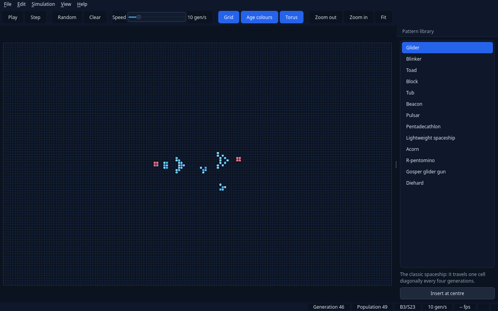

# Game of Life

An interactive Conway's Game of Life playground for the desktop, written in Python with PyQt6.



Draw cells with the mouse, drop in classic patterns from the built-in library, switch between
life-like rules, load and save patterns in the standard RLE format, and export the board as an
image. The simulation runs at an adjustable speed with smooth, CPU-friendly redraws.

## Features

- Fast set-based simulation with a configurable toroidal (wrapping) universe.
- Life-like rule engine with presets for Conway's Life, HighLife, Seeds, Day & Night and
  Diamoeba, plus arbitrary `B…/S…` rules.
- Pattern library with 13 classics: glider, blinker, toad, block, tub, beacon, pulsar,
  pentadecathlon, lightweight spaceship, acorn, R-pentomino, Gosper glider gun and diehard.
- Draw and erase with the mouse, pan with the middle button, zoom with the wheel, and stamp the
  selected library pattern with `Shift` + left click.
- RLE import and export, clipboard copy and paste, and PNG export of the current board.
- Undo and redo for every edit.
- Age-based cell colouring, optional grid lines, and live statistics in the status bar.
- Window geometry, speed, rule and view options are remembered between sessions.
- Keyboard-first workflow: every command has a shortcut.

## Requirements

- Python 3.10 or newer
- PyQt6 6.5 or newer
- A desktop session (X11 or Wayland)

## Installation

From a checkout of the repository:

```bash
python -m venv .venv
source .venv/bin/activate
pip install -e .
```

Alternatively, install the runtime dependency directly and run the package from the source tree:

```bash
pip install PyQt6
```

## Running

```bash
game-of-life
```

or, without installing the console script:

```bash
python -m game_of_life
```

## Controls

| Input | Action |
| --- | --- |
| `Space` | Start or pause the simulation |
| `N` | Advance one generation |
| `R` | Fill the board randomly |
| `C` | Clear the board |
| `A` | Toggle age-based colours |
| `G` | Toggle grid lines |
| `T` | Toggle the torus |
| `F` | Fit the board to the window |
| `Ctrl` + `Z` / `Ctrl` + `Shift` + `Z` | Undo / redo |
| `Ctrl` + `C` / `Ctrl` + `V` | Copy or paste a pattern as RLE |
| `Ctrl` + `O` / `Ctrl` + `S` | Open or save an RLE file |
| `Ctrl` + `E` | Export the board as a PNG image |
| Left mouse button | Draw live cells |
| Right mouse button | Erase cells |
| Middle mouse button | Pan the view |
| Mouse wheel | Zoom around the cursor |
| `Shift` + left mouse button | Stamp the selected library pattern |

## Rules

The simulation uses the usual life-like notation: `B` lists the neighbour counts that create a
live cell, and `S` lists the counts that let a live cell survive. Conway's Life is `B3/S23`.
Pick a preset or enter a custom rule from **Simulation → Rule…**.

## Patterns

Patterns are stored in the standard [RLE](https://conwaylife.com/wiki/Run_Length_Encoded) format.
The repository ships a few examples in `examples/`:

- `examples/gosper-glider-gun.rle`
- `examples/pulsar.rle`
- `examples/pentadecathlon.rle`

Open any of them with **File → Open RLE…** or load your own files created by other Life tools.

## Project layout

```
game-of-life/
├── game_of_life/
│   ├── __init__.py     package exports
│   ├── __main__.py     python -m entry point
│   ├── model.py        grid, rules and RLE serialisation (no Qt dependency)
│   ├── patterns.py     built-in pattern library
│   ├── view.py         canvas widget and mouse interaction
│   └── window.py       main window, menus, toolbar and dialogs
├── tests/
│   └── test_model.py   unit tests for the model
├── examples/           sample RLE patterns
├── docs/               screenshots
├── pyproject.toml
└── LICENSE
```

## Development

Run the test suite from the repository root:

```bash
python -m unittest discover -s tests
```

The GUI layer can be smoke-tested without a display:

```bash
QT_QPA_PLATFORM=offscreen python -m game_of_life --smoke
```

## License

Released under the MIT License. See [LICENSE](LICENSE) for details.
